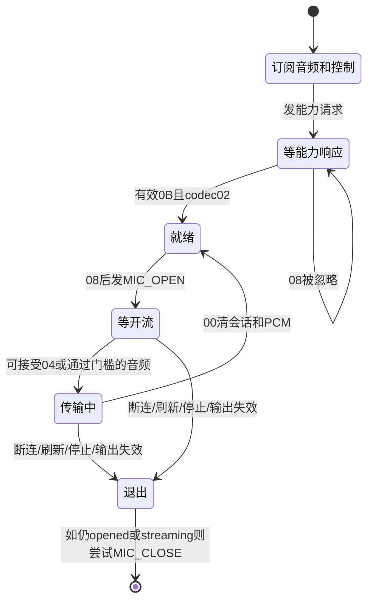

# ATVV 会话分析与 G10 实验边界

> 本文保留最初静态分析时的操作边界；其中“只展示、未写入”描述的是当时阶段。当前样机已完成受控握手和手动音频桥接验证，最新状态与暂停点请以 [HANDOFF.md](HANDOFF.md) 为准。

参考 commit：`a8c23b98fc6468013c9647a8b27646e5a9821303`。本文基于本地完整阅读的 `../axonkey-reference/src-tauri/src/audio_service/windows.rs` 和 `atvv.rs`；不把 RC003 实现当作 G10 协议保证。

## 连接与订阅顺序：RC003 源码事实

1. BLE worker 必须先看到可用的 CABLE Input 输出设备才尝试连接（windows.rs:491–508）。这是 AxonKey 的应用策略，不证明 BLE 握手依赖虚拟声卡。诊断工具只保存原始数据，不安装声卡。
2. `find_remote` 根据 ATVV 服务 UUID 枚举，再按服务实例路径中的 `_vid&012717_pid&32b8_` 限定 RC003（704–750）。**G10 的身份不同，原版 AxonKey 会过滤它**，仅有相同服务 UUID 不足以直接运行原版获得语音。
3. 连接后设置状态，清空解码器和 PCM，初始化协议状态：能力未确认、麦克风未打开、未 streaming，版本默认 0x0100、codec 默认 0x02、帧长默认 120（56–64、559–575）。默认值不是从 G10 测得的参数。
4. 取 TX=ab5e0002、AUDIO=ab5e0003、CONTROL=ab5e0004 三个特征（577–579）。先安装音频 ValueChanged handler，再装控制 handler（582–619）。
5. **先启用音频 CCCD，再启用控制 CCCD，随后主动发能力请求**（621–623）。不会订阅 TX 的通知。
6. 控制回调解析后将待发命令送入 mpsc 队列（604–608），BLE worker 在循环里发送，不在通知回调中执行写入（659–662）。

## 主机业务写入清单（当前仅展示，不执行）

所有命令目标均为 `ab5e0002-5a21-4f05-bc7d-af01f617b664`。G10 暴露 WRITE_WITHOUT_RESPONSE；上游优先选择该模式，否则回退 WRITE_WITH_RESPONSE（800–823）。Windows 写入返回 Success 仅表示 API 操作成功，不能当作设备已理解命令的应用层确认。

|命令|准确字节|时机和前置条件|源码|预期控制响应 / 风险|
|---|---|---|---|---|
|能力请求|`0A 01 00 00 03 03`|两项通知订阅成功后，连接初始化时发送一次|windows.rs:623|期望出现至少 7 字节的 `0B …`；G10 可能忽略、拒绝或采用其他版本，不能猜测重试变体|
|MIC_OPEN，版本 ≥0x0100|`0C 00`|能力响应支持 codec 02，收到控制 `08`，未 opened、未 streaming，且输出可用|875–890|期望有开始消息 `04 …` 或后续音频；G10 兼容性未知，可能不开始传输|
|MIC_OPEN，版本 <0x0100|`0C 00 02`|同上，仅在有效能力响应返回旧版本时选择|883–890|不能无响应时随意尝试两种形式；codec 01 不在上游 Windows 支持范围|
|MIC_CLOSE，版本 ≥0x0100|`0D SS`|关闭连接流程中，仅 opened 或 streaming 时发送；SS=开始消息第 4 字节，尚未获得则状态默认 00|673–687、896|期望结束会话，但上游没有等待关闭确认；G10 可能忽略，必须核对关闭后的实际通知|
|MIC_CLOSE，版本 <0x0100|`0D`|同上，由有效协商版本决定|677–683|不做猜测式版本切换|

这里用“能力请求/MIC_OPEN/MIC_CLOSE”表示源码中命令用途。不会根据这些字节自行推导未被源码证实的模式、采样率、错误码或保留字段。

标准通知订阅另涉及 AUDIO、CONTROL 特征的 CCCD 描述符写入：Notify=0x0001（ATT 值为 `01 00`），结束时恢复读取到的原值，不盲目清零。原值读取失败就不订阅。此项与 TX 业务命令分开授权。

## 控制通知状态机：RC003 源码事实

|操作码|实际处理|主机是否发送命令|
|---|---|---|
|`0B`|不足 7 字节报错；版本=`[1:3]` 大端；codec 位图先取 `[3]`，若版本≥1.0且它为0、`[4]&3 !=0` 则改取 `[4]`。位图含02选codec02，否则选01。帧长=`[5:7]`大端，0则回退120。仅codec02确认能力（837–873）|否|
|`08`|能力确认、未 opened、未 streaming、输出可用时，先设置 opened=true，再将 MIC_OPEN 入队；不满足则忽略。先到的08不会在能力确认后自动重放（875–890）|条件满足时 MIC_OPEN|
|`04`|能力已确认，且消息不足3字节或第3字节为02时接受；session id=`[3]`，缺省00；设置streaming，清解码器和PCM。若长度≥3且codec字段非02则报告不支持（892–922）。该源码对短消息宽松接受，不是完整协议有效性证明|否|
|`00`|重置会话：清 opened/streaming、清解码器/PCM并记录停止时刻；能力确认保留（114–135、924–927）|否；不是收到STOP就回发CLOSE|
|`0A`|长度至少7字节：predictor=`[4:6]`大端有符号16位，step index=`[6]`。解码器清 pending，下一帧应用同步值并限幅（929–935；atvv.rs:21–24、39–42）|否|
|其他，包括 `0C 01 0F`|落入 `_ => None`，不处理、不解释（938）|否|

## 音频处理与时间机制

- 音频 handler 先累计通知统计。空包拒绝；能力未确认则拒绝（943–957）。
- 未 streaming 时，如果上次 STOP 距今不足 300 ms，拒绝音频；否则可以直接由音频通知将状态转为 streaming，即**并非绝对必须先收到04**（958–968）。
- `AtvvDecoder.append` 将字节跨通知累积，按 frame_size 拆帧，不假设一个 BLE 通知就是一帧。先解高半字节再低半字节，IMA ADPCM predictor/index 跨帧保留，并执行邻点平滑（atvv.rs:26–108）。
- Windows 源码固定 PCM 源采样率为16 kHz、预缓冲320样本即20 ms，队列最大2秒（38–40）。STOP立即清队列；**没有松键后尾音排空保证**。
- 每100 ms左右检查连接并等待命令队列；每1秒诊断。队列 recv_timeout 的100 ms不是能力响应或MIC_OPEN超时（638–668）。
- **未发现显式能力响应超时、开流超时或静默重发机制。** 因而不能用上游源码解释 G10 的约3秒 `0C 01 0F` 为某种已知超时码。
- 蓝牙断连、输出端点失效、命令发送失败或命令队列断开会退出run；close条件发送MIC_CLOSE、移除handler、关闭本进程资源、重置会话；worker等待2秒后重试。用户 stop/refresh 也会退出（491–543、638–701）。close发送错误被忽略；连接初始化半途失败也没有本项目这种逐项订阅恢复日志。

## G10 已证实与待验证

已证实：G10 的ATVV UUID结构与上述一致；第一阶段两轮 `08` → 约3秒后 `0C 01 0F`；音频订阅成功但零包；红键触发 Windows 搜索，且有对应HID报告。身份为620A:0407，不能冒充RC003。

待验证：能力响应是否采用上述布局；是否必须主机协商和MIC_OPEN才能开流；`0C 01 0F` 的含义；物理松键与STOP的关系；编码、采样率、帧长、半字节顺序、同步语义，以及关闭会话的行为。

## 本轮只读验证设计

三组：短按、按住说话5秒、按住说话10秒。每组前提示，松开后额外观察6秒。使用电脑F8与红键同步按下/松开作为**人工标记**，10 ms轮询；操作不同步、Windows调度与蓝牙传输都有误差。不会把F8、HID零报告或控制08当作遥控器物理开关的精确硬件时间戳。

BLE通知记录回调接收 `perf_counter_ns`、Unix时间、WinRT通知时间；HID观察器使用同一系统单调时钟；精确数值不代表纳秒测量精度。持续观察连接事件、GATT session事件和100 ms状态轮询。订阅失败/回调异常/断连停止实验并恢复本次CCCD，记录恢复成败。静默本身不等于订阅失效，不能只凭零包判定订阅失败。

原始音频如出现只写本地二进制文件，JSONL保存每包偏移、包长和时间，不上传。没有足够编码证据就不生成“默认16k ADPCM”的WAV。出现数据后先查能力消息、帧边界、同步语义和语音可理解性，再决定是否解码。

本轮工具不包含 GATT 特征写入调用。`--plan` 仅显示上表的受控业务命令计划。用户未逐项同意之前，不添加或启用业务写入路径。后续获准实验将只向TX发上述命令，采用单次能力请求、明确协商门槛、有限等待、不自动重连重试的策略；这些保护与上游无握手超时/自动重连策略的区别须在实测中记录。

## 来源

- [Windows ATVV实现（固定commit）](https://github.com/leowzz/axonkey/blob/a8c23b98fc6468013c9647a8b27646e5a9821303/src-tauri/src/audio_service/windows.rs)
- [Rust ATVV解码器（固定commit）](https://github.com/leowzz/axonkey/blob/a8c23b98fc6468013c9647a8b27646e5a9821303/src-tauri/src/audio_service/atvv.rs)
